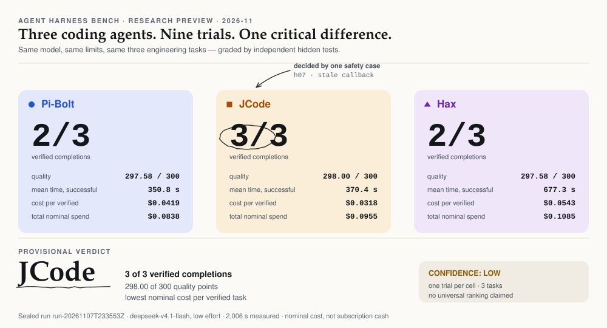
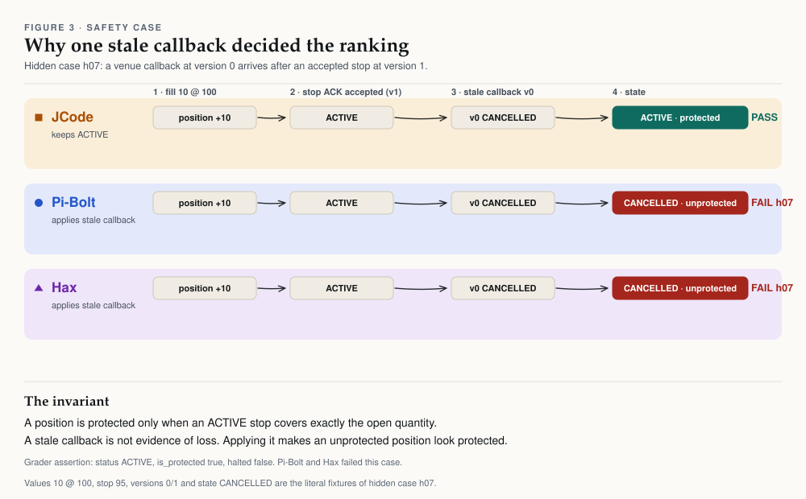
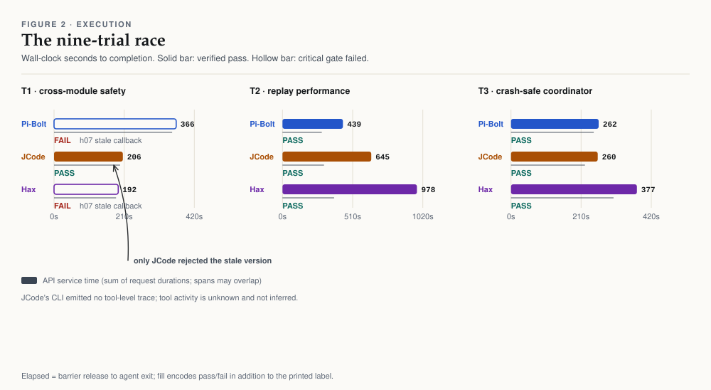
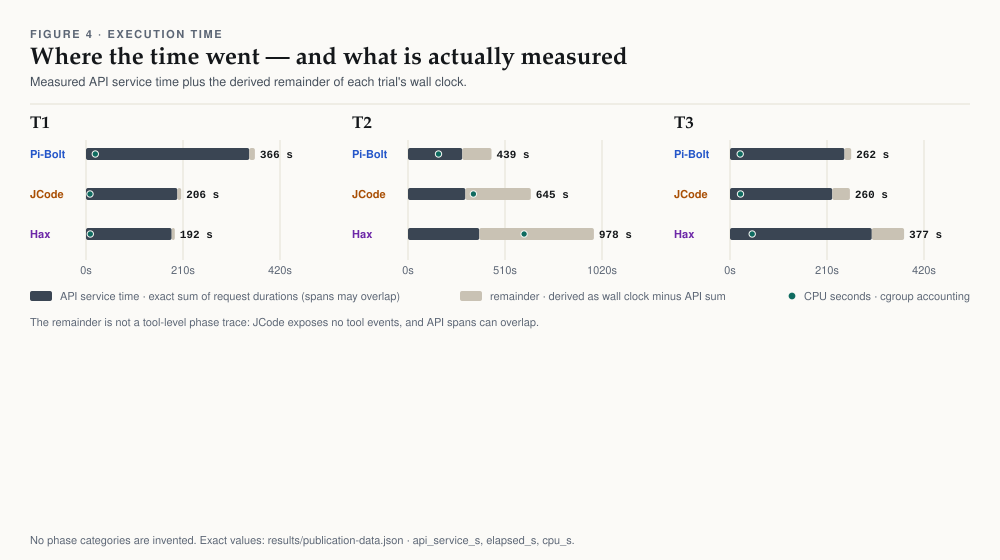
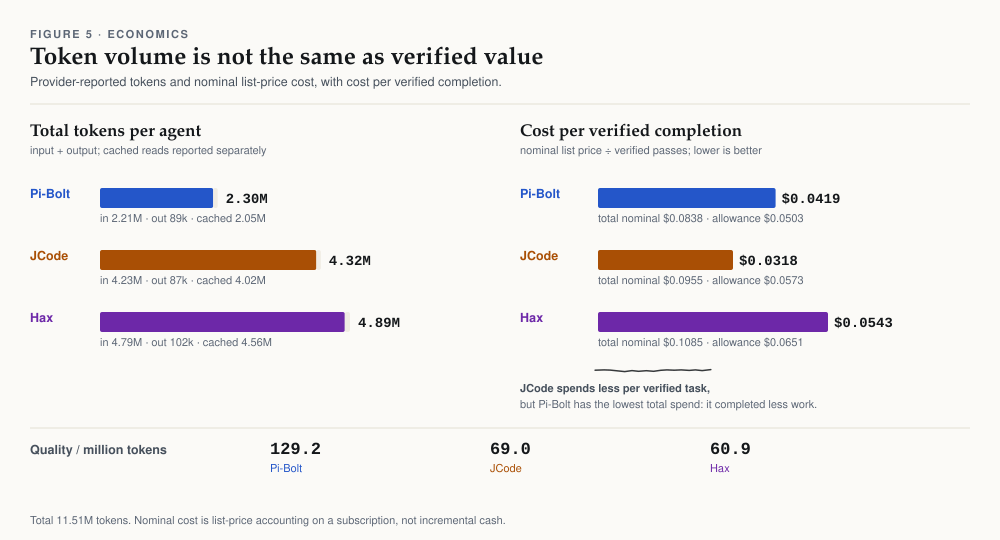
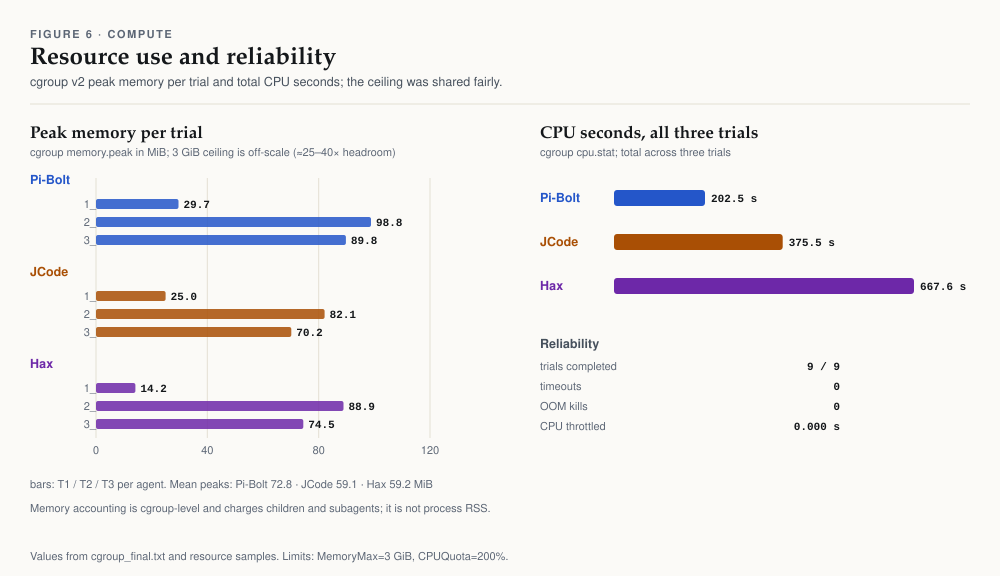

# Agent Harness Bench

**Three coding agents. Nine trials. One critical difference.**

An evidence-first comparison of [Pi-Bolt](https://github.com/opensec-git/Pi-Bolt),
[JCode](https://github.com/CHWEZI19/jcode) and [Hax](https://github.com/OleksandrChekhovskyi/hax)
on three engineering tasks, with the same provider, model and reasoning effort,
independent hidden graders, cgroup v2 resource accounting and provider-reported
token usage.

<picture>
  <source media="(prefers-color-scheme: dark)" srcset="assets/hero-dark.svg">
  
</picture>

**Provisional result:** JCode completed all three tasks. Pi-Bolt and Hax completed
two. The difference was not speed or token volume: it was one critical
stale-callback safety test. Confidence is **LOW** — this is one trial per
agent-task on three tasks, a screening exercise rather than a universal ranking.

- [Read the full forensic report](reports/AGENT_BENCHMARK_FORENSIC_REPORT.html)
- [Open the research page](site/index.html)
- [Methodology](docs/METHODOLOGY.md) · [Results](docs/RESULTS.md) · [Limitations](docs/LIMITATIONS.md) · [Reproduce](docs/REPRODUCE.md)

## The result

| Task | Pi-Bolt | JCode | Hax |
|---|---|---|---|
| T1 — cross-module execution safety | **FAIL** 97.58 · stale-callback gate | **PASS** 98.00 | **FAIL** 97.58 · stale-callback gate |
| T2 — replay performance under parity | **PASS** 100.00 · 4.99× | **PASS** 100.00 · 5.10× | **PASS** 100.00 · 5.63× |
| T3 — crash-safe job coordinator | **PASS** 100.00 | **PASS** 100.00 | **PASS** 100.00 |
| **Verified completions** | **2 / 3** | **3 / 3** | **2 / 3** |

A pass requires every P0 gate and a score of at least 80/100. Pi-Bolt and Hax
scored 97.58 on T1 but failed a critical gate, so their work is recorded as
partial engineering progress — not a verified completion. The gate is not
cosmetic: it distinguishes a system that keeps an open position protected from
one that reports protection it does not have.

| | Pi-Bolt | JCode | Hax |
|---|---:|---:|---:|
| Verified passes | 2 / 3 | **3 / 3** | 2 / 3 |
| Quality points (of 300) | 297.58 | **298.00** | 297.58 |
| Mean wall clock, successful trials | **350.8 s** | 370.4 s | 677.3 s |
| Total CPU seconds (3 trials) | **202.5** | 375.5 | 667.6 |
| Mean peak cgroup memory | 72.8 MiB | **59.1 MiB** | 59.2 MiB |
| Tokens (all trials) | **2.30 M** | 4.32 M | 4.89 M |
| Nominal list-price spend | **$0.0838** | $0.0955 | $0.1085 |
| Nominal cost per verified task | $0.0419 | **$0.0318** | $0.0543 |

The multi-objective answer is not a single winner on every axis: Pi-Bolt is
fastest per successful task and has the lowest total spend because it completed
less work; JCode has the most verified completions, the highest quality subtotal,
the lowest cost per verified task and the lowest mean memory; Hax has the
strongest replay speed-up but the longest and most expensive run.

## Why JCode won

<picture>
  <source media="(prefers-color-scheme: dark)" srcset="assets/safety-dark.svg">
  
</picture>

Hidden case `h07` delivers a venue callback at **version 0** reporting the
protective stop `CANCELLED`, after an accepted acknowledgement had established
protection at **version 1**. The invariant is strict: a position is protected
only while an `ACTIVE` stop covers exactly the open quantity. A stale callback
is not evidence of loss; applying it makes an unprotected position look
protected.

JCode treated callback versions as monotonic and kept protection `ACTIVE`.
Pi-Bolt and Hax failed the case. The T1 P0 gate overrides the numeric score, so
both are 2/3 despite averaging 97.58 on the remaining cases.

## What we measured

<picture>
  <source media="(prefers-color-scheme: dark)" srcset="assets/race-dark.svg">
  
</picture>

Three tasks, each capped at 28 minutes and graded by hidden tests written
outside every agent-readable tree:

1. **T1 — cross-module execution safety.** Repair a deterministic order
   protection lifecycle with partial fills, delayed acknowledgements, cancel
   races, stale callbacks, duplicate fills, restart replay and native identity
   checks. P0 gates override the score.
2. **T2 — replay performance under parity.** Make a correct replay engine at
   least 3× faster on large workloads while preserving byte-identical output.
   Hidden checks generate fresh event streams; parity failure zeroes performance.
3. **T3 — crash-safe coordinator.** Implement atomic claims, leases, heartbeat,
   crash recovery, bounded retries and idempotent completion on SQLite. Hidden
   tests use concurrent processes and real `SIGKILL` crashes.

All nine trials completed; there were no timeouts, crashes, OOM kills or
throttling. Every chat request passed through a per-trial relay: 261 requests,
all provider-reported usage, one model identity observed.

## Where the time went

<picture>
  <source media="(prefers-color-scheme: dark)" srcset="assets/timing-dark.svg">
  
</picture>

The exact measurement is wall clock from the shared start barrier to process
exit. The dark segment is the sum of API request durations (measured, but
overlapping spans may not add to elapsed time). The light segment is the derived
remainder. This is **not** a tool-level phase trace: JCode's CLI emitted only a
final result, so its tool activity is unknown and is not inferred.

## Tokens and cost

<picture>
  <source media="(prefers-color-scheme: dark)" srcset="assets/economics-dark.svg">
  
</picture>

Costs are **nominal list prices** from provider usage on an OpenCode Go
subscription, not incremental cash charged. Cached input is reported separately
and is not added to the totals again. Cost per verified task is undefined when
nothing passes, and is never displayed as zero.

## Compute and reliability

<picture>
  <source media="(prefers-color-scheme: dark)" srcset="assets/resources-dark.svg">
  
</picture>

Each trial ran in its own systemd user scope with `MemoryMax=3 GiB`,
`CPUQuota=200%` and `TasksMax=4096`; CPU affinity rotated across three groups of
two cores. Memory is cgroup-level and charges children and subagents; it is not
process RSS. Peak usage never exceeded 99 MiB, so the ceiling was not a
constraint — the measured differences are real, not limit artefacts.

## How the benchmark was controlled

- Identical provider, model (`deepseek-v4.1-flash`) and `reasoning_effort=low`
  for every competitor **and every subagent**, pinned at a loopback relay.
- The real credential never entered an agent workspace; agents received a dummy
  token and all traffic was recorded by the relay.
- Hidden graders, oracle patches and negative controls lived outside every
  readable workspace; the origin remote was removed.
- Independent graders were validated with reference solutions, seven to eight
  negative controls per task, and repeated determinism checks.
- Per-task barriers, a global 120-minute watchdog, frozen snapshots and a
  SHA-256 evidence seal.
- The benchmark controller and reporting tooling are deterministic; no LLM
  decides when to start, stop, pass or fail.

## Why confidence is low

One trial per agent-task cannot establish statistical superiority. Three tasks
are a sample of one possible workload mix. All agents shared a VPS, a provider
account and one Unix user; isolation was cgroup/process based, not a security
boundary. Provider contention and VPS scheduling remain confounders. JCode's
tool trace is missing. The benchmark was built by the Pi-Bolt author — graders
and controls were independently validated, but authorship is a real bias risk.
And the historical graders are now public, so they must not be reused as hidden
tests for future competitions.

The defensible conclusion is narrow:

> **JCode completed all three tasks. Pi-Bolt and Hax completed two. The
> difference came from one critical stale-callback safety test.**

## Reproduce

```bash
# 1. rebuild the sanitized dataset from the sealed run (not redistributed)
python3 tools/derive_data.py --source <sealed-run> --out results

# 2. regenerate the twelve SVGs and verify byte-identical output
python3 tools/make_charts.py
python3 tools/make_charts.py --check

# 3. rebuild the site and verify it is current
python3 tools/build_site.py
python3 tools/build_site.py --check

# 4. release gates
python3 tools/check_svg.py
python3 tools/check_contrast.py
python3 tools/check_publish.py
python3 tools/verify_publication.py
```

The charts are generated from `results/publication-data.json`, which is itself
derived from the sealed evidence with a recorded transformation and zero
reconciliation discrepancies. Visual QA uses Playwright; see
[`docs/REPRODUCE.md`](docs/REPRODUCE.md).

## Repository layout

```
assets/       6 figures × light/dark, generated, with title/desc/aria labels
harness/      the benchmark controller, three task fixtures, graders and scripts
reports/      sanitized single-file forensic report (+ seal and original hash)
results/      publication dataset, sanitized telemetry, transformation record
site/         self-contained static research page (GitHub Pages ready)
tools/        data derivation, chartkit, chart/site generators, release checks
docs/         design system, methodology, fairness, results, limits, security
tests/        publication consistency and Playwright visual QA
```

## Citation, license and attribution

Code is released under the MIT license (see [LICENSE](LICENSE)). The benchmark
tasks, sanitized data and figures are published for research reproducibility.
The chart philosophy and several primitives are adapted from the author's
previous benchmark, [goal-extension-benchmark](https://github.com/ddawnlll/goal-extension-benchmark);
see [docs/ATTRIBUTION.md](docs/ATTRIBUTION.md). Agent names and repositories
belong to their respective authors.

If you use this work, cite it via [CITATION.cff](CITATION.cff).

## Security

Only sanitized derivatives are published: no credentials, no home paths, no
hostnames, no raw workspaces and no unsanitized logs. The forensic report is a
sanitized derivative whose original hash and transformation are recorded in
`reports/SEAL.json`. See [docs/SECURITY.md](docs/SECURITY.md) to report a leak.
